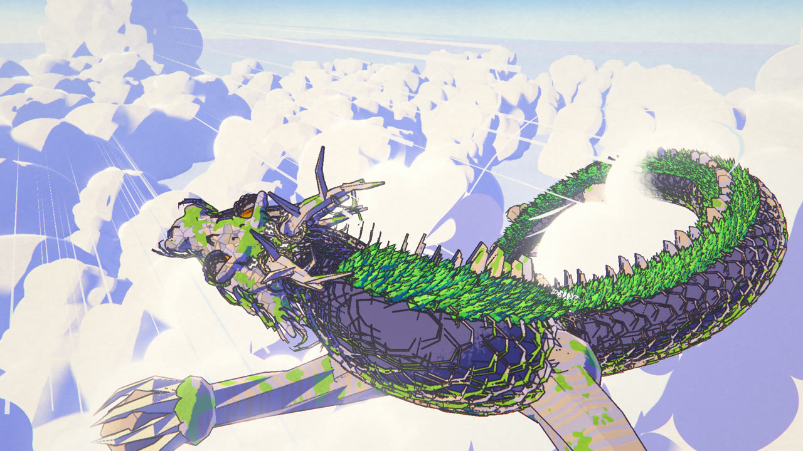
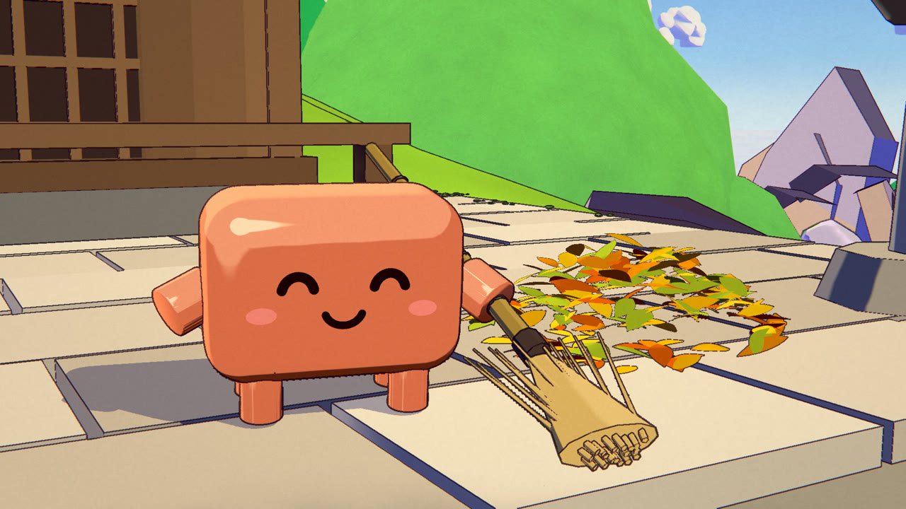
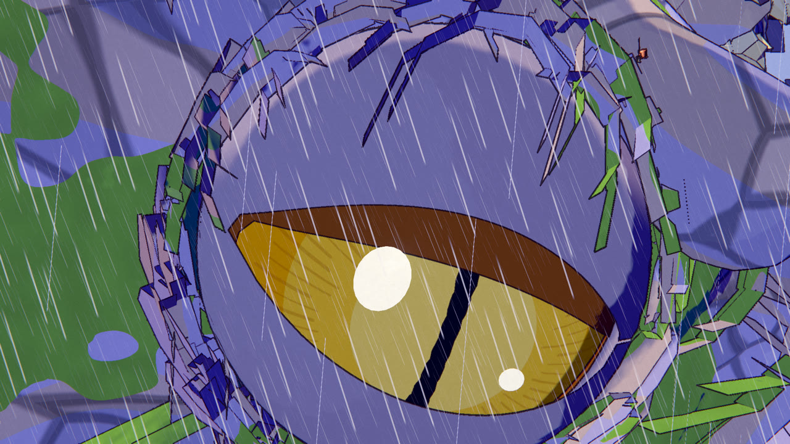
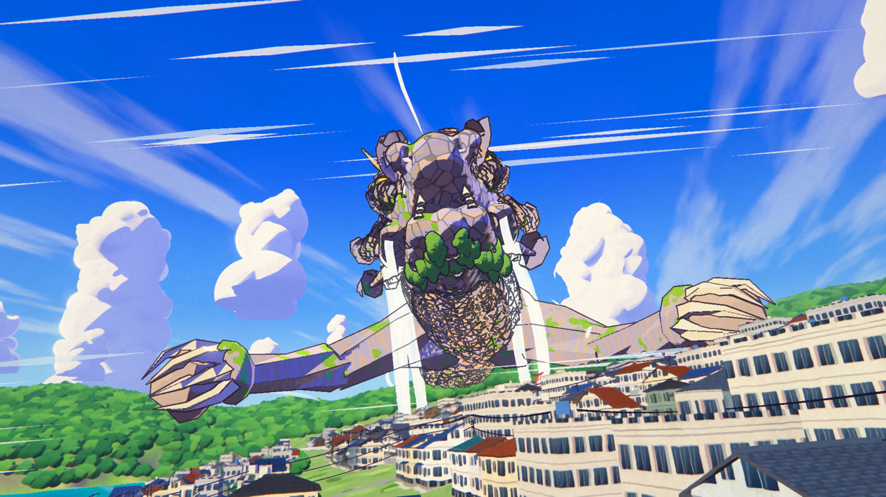
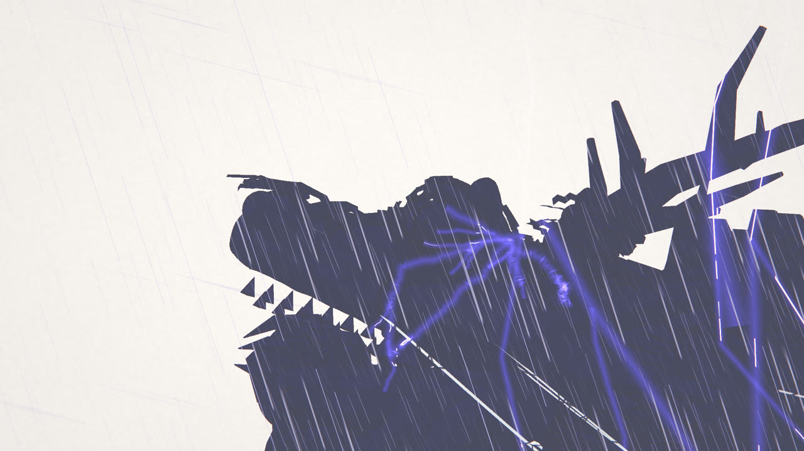
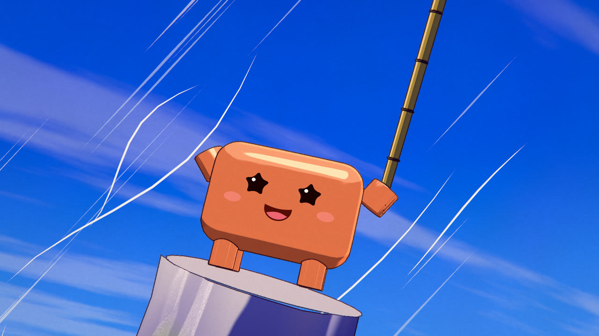
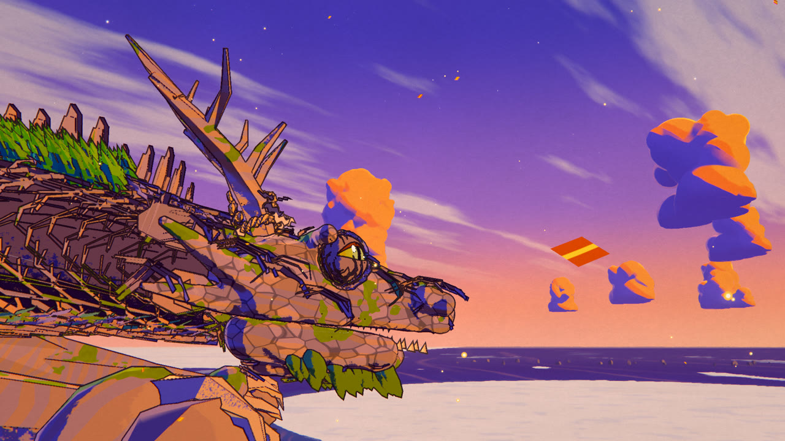

# RYŪ · 龍

A 76-second anime short where every frame is rendered by code: no video model, no image model, no hand-drawn frames.



| | |
|---|---|
|  |  |
|  |  |
|  |  |

**Watch:** download `dist/ryu.html` (1080p) or `dist/ryu_lite.html` (960×540, for lighter GPUs) and open it in any
browser with a GPU. Each is one self-contained file (6.4 MB): the player renders the film live in WebGL2 with the
soundtrack inlined, and works offline. To get the MP4, render it yourself with `npm run build` (below).

> An original story and original designs, series **Fable 5.5 Anime Lab**. Made with Fable 5.5.
> How the agent teams were organised is in [docs/WORKFLOW.md](docs/WORKFLOW.md).

---

## The story

A blazing summer day on a small green island. On its peak, in a tiny shrine, little Clawd sweeps the stone steps. One
leaf falls on the clean step. He chases it, trips on the rope of the old bronze bell, and the bell rings. The whole
forest ripples like fur. The mountain opens one amber eye: it was a dragon all along, and the shrine stands between its
horns. It rises with Clawd hanging on and takes off, screaming low over rice fields and a seaside town, out over the sea
and straight into a wall of storm. Lightning hits it. Clawd crawls along its brow and scratches it behind the eye with
his broom. The eye softens. The dragon bursts out above the storm into a sea of sunlit cloud, and Clawd stands on its
horn with his nubs up. At dusk it flies home, coils back into the island and closes its eye. Covered in leaves, Clawd
sweeps the steps again. One leaf falls. He sighs, smiles, and sweeps it.

## Why it looks like anime

One three.js (r160, WebGL2) scene drawn through a custom multi-pass pipeline that imitates a cel + painted-background
production:

| Pass | What it does |
|---|---|
| shadow / reflection | character-only shadow map (painted lighting, not physics); mirrored camera for the sea |
| main (MRT) | colour + a data buffer (view normal, depth, material id: background / cel / FX) |
| paint | depth-aware anisotropic Kuwahara "brush" filter on background pixels only: gouache look |
| ink | hand-inked lines on cel pixels only: id / depth / normal edges, pressure noise, thickness by distance |
| atmosphere | height haze, sun scatter, sea mist |
| overlay | drawn lightning, wind, rain and water FX, after paint + ink |
| bloom / grade | glow on emissives, high-key anime grade, lavender shadows / warm highs, flash, film grain |

* **Everything is 3D under the drawing.** Clawd is the project mascot, shaded with two hard tones and a crisp highlight.
  The dragon is 1.5 km long: a spline with instanced rock plates, a cedar forest along the spine, antlers wrapped in
  shimenawa, waterfalls from the jaw, four legs with claws, and an eye drawn as a flat amber iris and slit in an almond
  of real rock lids.
* **Clawd and his props do not clip.** Besides the box solids, the broom shaft and bristles, the bell rope, the nubs and
  the legs are tested as segments against his rounded body on every frame (`src/keeper-contacts.js`). The broom is one
  straight stick through the grip: a small solver turns the line about the grip exactly as far as it would otherwise
  pass through him, and slides it along itself to keep the fan on the stone.
* **Animation is on twos and threes**, like film anime: characters at 12 drawings a second, water FX at 8, the camera on
  every frame.
* **Every frame is a pure function of time.** No `Math.random`, no carried state: frames render in any order, so the
  headless render is resumable and deterministic, and `tools/check.mjs --purity` proves it: each sampled frame must
  match when rendered after a far-away frame.
* **Sound is fully synthesized** with Web Audio `OfflineAudioContext`, no samples: an original score locked to the story
  beats (`CUES` in `src/shots.js`), mastered in JS to -14.0 LUFS with a -2.4 dBTP true peak.

Numbers: 30 shots, 1824 frames at 24 fps, 1920×1080. A frame took about 0.21 s at 1080p on an RTX 2060 with PNG encoding
included, so one process renders the whole film in about 7 minutes. About 7,300 lines of JavaScript (`src/` and `tools/`,
three.js not counted).

## How it was made

One director session and 7 agent teams in Claude Code, working from a shared production bible
([CONTRACT.md](CONTRACT.md)): an engine port first (the pipeline and tools of the earlier Anime Lab film MEGA CLAWD),
then five departments in parallel (dragon, keeper, world, fx, sound), each owning its own files and its shots' cameras.
The director integrated them and rendered a draft. A person watched that draft and listed what was wrong; one
fix-and-final pass took that list to the end. Details: [docs/WORKFLOW.md](docs/WORKFLOW.md), engine notes:
[docs/ARCHITECTURE.md](docs/ARCHITECTURE.md).

## Shots

| Act | Time | Shots | What happens |
|---|---|---|---|
| Summer | 0–15 s | s01–s06 | the island, the shrine, Clawd sweeping, one leaf, the trip on the rope, DONG |
| The waking | 15–33 s | s07–s13 | birds, the forest ripples, the eye opens, the dragon rises with the shrine between its horns, Clawd on the rope |
| The flight | 33–47 s | s14–s18 | the dive off the island, the rice fields, the town, the horn, the sea |
| The storm | 47–57.5 s | s19–s23 | the wall, inside, the strike, the scratch behind the eye, the eye softens |
| Breakout | 57.5–63.5 s | s24–s25 | through the storm top into sunlit cloud, Clawd on the horn |
| Home | 63.5–73 s | s26–s29 | dusk glide, the coil into the island, the eye closes, one more leaf |
| Card | 73–76 s | s30 | "Fable 5.5" brush lettering + 寓話 seal, RYŪ 龍 |

The full shot list with every beat is in [CONTRACT.md](CONTRACT.md) and `src/shots.js`.

## Run it

Requirements: Node 20+, a GPU with WebGL2 (the tools refuse a software renderer unless you pass `--allow-sw`), `ffmpeg` +
`ffprobe` on `PATH` (`FFMPEG=/path/to/ffmpeg` overrides ffmpeg). Chromium comes with Playwright (or set
`CHROME=/path/to/chrome`).

```bash
npm install
npx playwright install chromium
```

**Live.** Serve the folder with any static server and open `index.html` to scrub through the film:

```bash
npx serve .
# then open http://localhost:3000/?scale=1
```

| URL parameter | What |
|---|---|
| `?t=41.5` · `?f=300` · `?shot=s16` (`s16@0` first frame, `s16@1` last) | jump to a time, frame or shot |
| `?scale=1` | full 1920×1080 (default `2` = 960×540) |
| `?play=1` | start playing |
| `?cam=x,y,z&at=x,y,z&fov=40` | free debug camera |
| `?look={json}` | override any look knob (see `BASE_LOOK` in `src/pipeline.js`) |
| `?debug=id\|depth\|normal\|mask\|raw` | show a pipeline buffer |
| `?groups=town,sea` · `?labels=1` · `?dragon=0` · `?grain=0` | force set groups, show labels, skip a department, no grain |

Keys: space play / pause · ←/→ one frame · shift+←/→ one second · `[` `]` previous / next shot · H hide the bar · F
fullscreen.

**Stills.** Any frame headless at full resolution. They go to `WORK/snap/`, or to `--out <dir>`:

```bash
node tools/snap.mjs --scale 1 s:s16 s:s24@0 t:41.2 f:300
node tools/snap.mjs --scale 2 all3 --sheet all3
```

**Full build.** Soundtrack, film (resumable PNG frames), the single-file players in `dist/`, the MP4:

```bash
npm run build
```

`npm run build` = `tools/render-audio.mjs` → `tools/render.mjs` → `tools/build-player.mjs` → `tools/encode.mjs`. Work files
(frames, WAV, MP4) go to `WORK` = `%LOCALAPPDATA%\Temp\ryu-work\<team>` on Windows, `./WORK/<team>` elsewhere, or `MC_WORK`
(the default team is `engine`). `node tools/encode.mjs --out <name>` picks the output name. Check every rendered frame:
`node tools/check.mjs --frames frames --step 1 --purity 60`. The released film was rendered at 3840×2160 and downsampled to
1080p so no ink line has a stair-stepped edge: `node tools/render.mjs --scale 0.5 --fmt jpg --out frames4k`, then
`node tools/encode.mjs --frames frames4k --fmt jpg`.

| Tool | What |
|---|---|
| `tools/snap.mjs` | stills by shot / time / frame / free camera, `--sheet` contact sheet, `--measure` Clawd's hue |
| `tools/render.mjs` | film frames → PNG in chunks of 96, resumable, any order, parallel |
| `tools/render-audio.mjs` | `audio.html` → `soundtrack.wav` + `.m4a`, loudness / spectrum / cue report |
| `tools/encode.mjs` | frames + WAV → H.264 High, yuv420p, BT.709, 24 fps CFR, AAC 192k, faststart |
| `tools/build-player.mjs` | `dist/ryu.html` (1080p) + `dist/ryu_lite.html` (960×540): every module, asset and the soundtrack inlined |
| `tools/check.mjs` | QC: page errors, solids and the keeper's segment vs rounded body tests, luma jumps > 25 tv levels, blank and frozen frames, `--purity` |
| `tools/sheet.mjs` | contact sheet of a folder |

## Layout

```
index.html           live scrub page (import map -> vendor/three, no CDN)
audio.html           renders the soundtrack (used by tools/render-audio.mjs)
CONTRACT.md          the production bible: story, designs, art direction, shots, ownership, quality gates
LICENSE              MIT
docs/                ARCHITECTURE.md (engine notes), WORKFLOW.md (how the teams worked), stills/, film-sheet.jpg
src/shots.js         the 30 shots and the story beats (CUES): one clock for picture, sound and QC
src/main.js          engine entry: boot, module API, frame loop, headless API
src/ui.js            the live scrub bar + keys (also in the player)
src/pipeline*.js     the anime pipeline: passes, cel / paint materials, painted-set kit, collisions
src/cams/            cameras and looks for each department's shots
src/dragon*.js       the dragon: path, head and eyes, rock plates, cedar forest, legs
src/keeper*.js       Clawd's acting, the broom, the contacts; src/shrine*.js the shrine, the bell, the hero horn and brow
src/world*.js        the island, the rice plain, the town, the harbour; src/ocean.js the sea; src/sky*.js skies, cumulus, the storm
src/fx*.js           drawn FX: rocks, trees, waterfalls, wind, spray, rain, lightning, the cloud burst
src/audio*.js        the synthesized score, sound design, synth kit, mastering + analysis
src/assets/clawd/    the mascot model + emotion library
tools/               snap, render, render-audio, encode, build-player, check, sheet
player/player.html   the single-file player template
dist/                the built single-file players
vendor/three/        three.js r160 (only the files the film imports, MIT)
```

## License

MIT © 2026 seeconever, see [LICENSE](LICENSE). three.js is MIT (`vendor/three/LICENSE`).
Series: Fable 5.5 Anime Lab.
